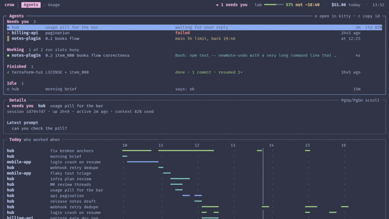
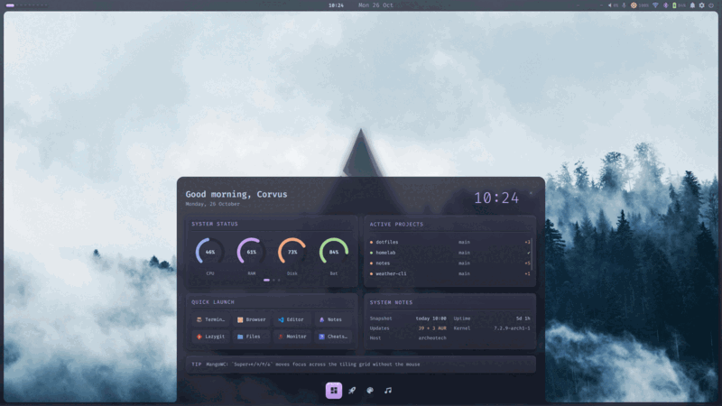
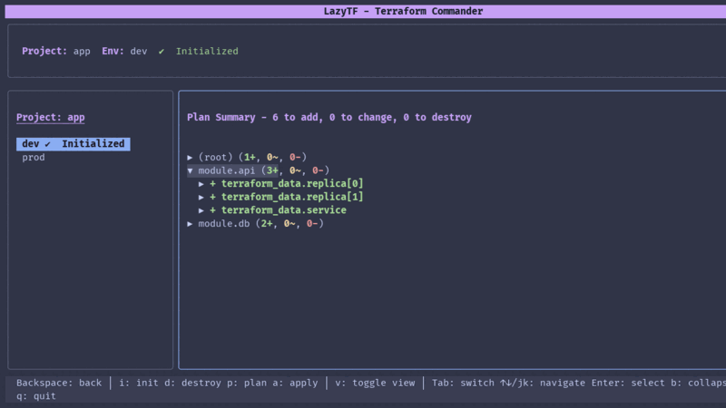
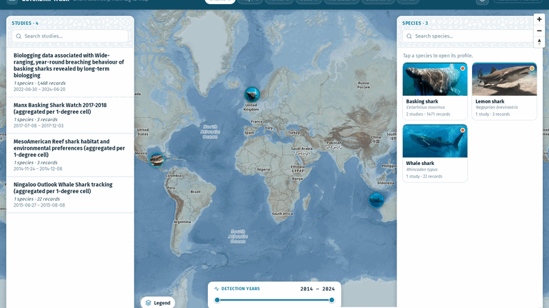
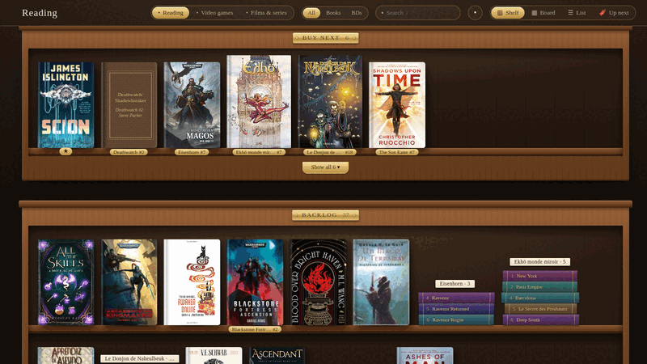
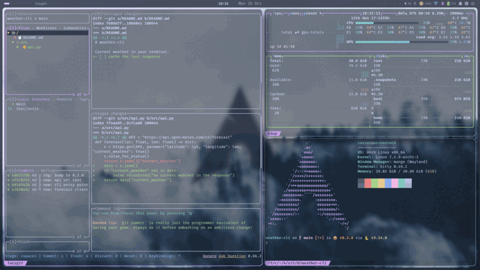

<table>
<tr><td width="50%" valign="top"> <b><a href="https://github.com/Nicolas-Rigaudy/cr-0w">CR-0W</a></b> A chief of staff for developers running several repos and agent accounts. One terminal board for agents, usage and limits.</td><td width="50%" valign="top"> <b><a href="https://github.com/Nicolas-Rigaudy/archeotech-shell">Archeotech shell</a></b> Your desktop, your rules. A Quickshell desktop shell for MangoWC and Hyprland where you change the layout, the look and the behaviour from inside, while it runs.</td></tr>
<tr><td width="50%" valign="top"> <b><a href="https://github.com/Nicolas-Rigaudy/lazytf">LazyTF</a></b> Terraform across every environment and cloud account from one terminal UI. Switch env, log in, then plan or apply with one key.</td><td width="50%" valign="top"> <b><a href="https://github.com/Nicolas-Rigaudy/lorenzini-track">Lorenzini Track</a></b> Follow sharks across the ocean on simulated tag telemetry. An open research project.</td></tr>
<tr><td width="50%" valign="top"> <b><a href="https://github.com/Nicolas-Rigaudy/obsidian-stacks">Stacks</a></b> An Obsidian plugin that turns your notes into a shelf. Manage books, games, films and series by category and status.</td><td width="50%" valign="top"> <b><a href="https://github.com/Nicolas-Rigaudy/archeotech-dotfiles">Archeotech dotfiles</a></b> My Arch Linux setup on MangoWC, managed with GNU Stow.</td></tr>
</table>

#### Contributions
- [cdx-manager](https://github.com/AlexAgo83/cdx-manager)
